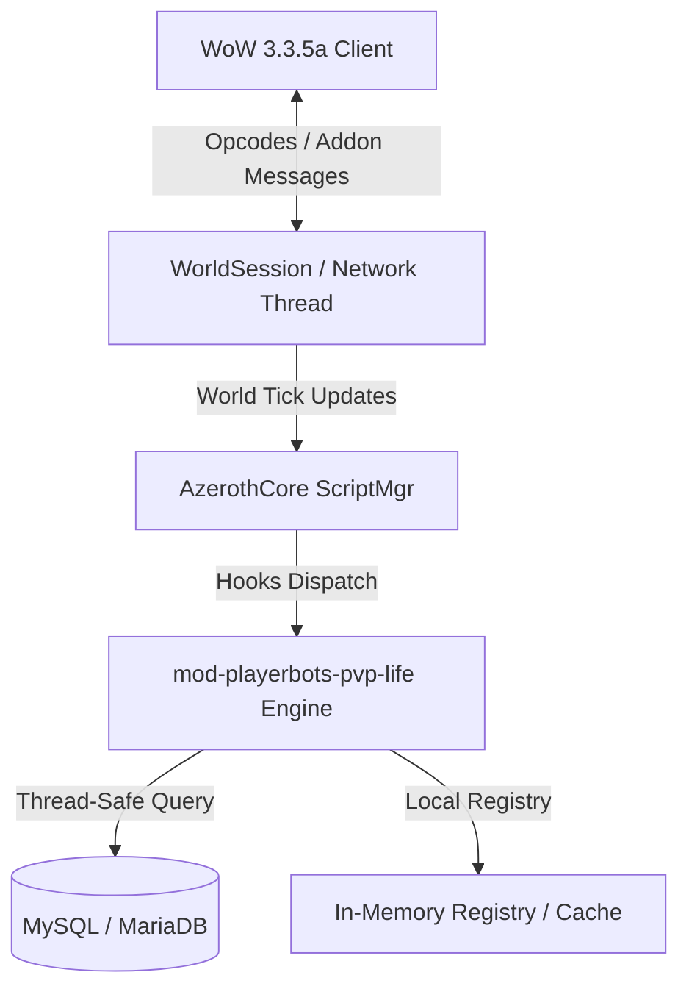

# Architecture Specification: `mod-playerbots-pvp-life`

## 1. System Overview
`mod-playerbots-pvp-life` (Playerbots PvP Life & World Skirmishes) is an AzerothCore modular extension designed to enhance the WotLK 3.3.5a engine.

### Functional Summary
Spawns autonomous rival faction playerbots into contested world zones, orchestrating emergent world PvP clashes and territory defense.

---

## 2. Subsystem Structure & Component Interactions

### Key Components
1. **Script Registration**: Hooks into AzerothCore via `ScriptMgr` loaders (`PlayerScript`, `CreatureScript`, `WorldScript`, `GossipScript`).
2. **Configuration Subsystem**: Loads module settings from `conf/mod-playerbots-pvp-life.conf.dist` during `WorldScript::OnConfigLoad`.
3. **Data Layer**: Persistent state stored in MySQL `characters` or `world` tables, with RAM caching for fast per-tick evaluation.

---

## 3. Threading & Concurrency Model
- **World Loop Execution**: All entity evaluations take place on the single-threaded world tick. Zero blocking I/O is permitted.
- **Asynchronous Execution**: Worker tasks or database writes utilize asynchronous query callbacks (`CharacterDatabase.AsyncQuery` or dedicated worker threads).
- **Concurrency Protection**: Shared state across player sessions is protected using RAII locks (`std::mutex`, `std::recursive_mutex`).

---

## 4. Architectural Invariants
- World PvP skirmishes must respect zone faction guard rules and graveyard distances.
- PvP bots must disengage if non-PvP flagged players are nearby to prevent griefing.
- Combat threat and target evaluation must update at regular AI intervals without spiking world ticks.
