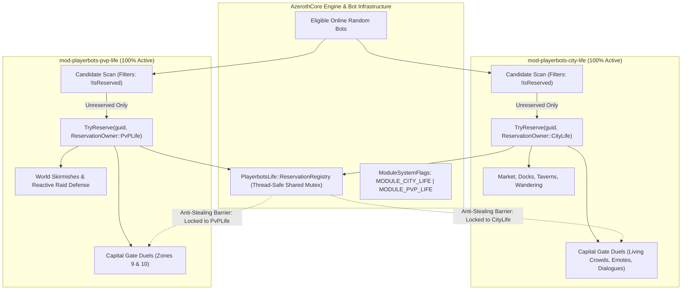

# Integrate World PvP into Playerbots PvP Life

## CRITICAL-01 — One installed PvP module with complete World PvP feature ownership

**This is the plan's only critical flag and its release gate.**

The completed integration must provide every World PvP capability from inside `mod-playerbots-pvp-life`. Users install only this PvP module alongside AzerothCore's Playerbot branch and the normal `mod-playerbots` dependency. `mod-playerbots-world-pvp` must be completely unnecessary for building, configuring, installing, or running the result.

All required implementation, helper code, headers, loaders, configuration, commands, schemas, migrations, seeds, and documentation must ship with PvP Life. Every imported feature must work from that package, including features disabled by default that users can enable through PvP Life's configuration.

Keeping World PvP installed with `PlayerbotWorldPvp.Enable = 0`, linking to its checkout, copying runtime files from it, using its command handlers, or requiring its tables on a fresh installation does not satisfy this gate. World PvP is an inspection and development input only.

Consolidation means implementing a source capability through equivalent code owned by PvP Life. It must not mean omitting the capability, leaving a stub or unread setting, delegating execution to the old module, or making users install another provider. Preserve the agreed optional offline-login toggle and other feature defaults; default-disabled functionality must still be fully implemented in the main module.

All remaining sections are implementation and verification requirements for this single gate. Do not add other critical flags or downgrade this requirement. Do not describe the integration as complete or release-ready until standalone operation and complete feature ownership have been verified; source-only delivery must identify any pending compilation, MySQL, and runtime checks explicitly.

---

## 1. Objective, framework, and agreed defaults

Make `mod-playerbots-pvp-life` the authoritative, self-contained PvP module and carry every existing capability from `mod-playerbots-world-pvp` into it.

**Installation requirement:** the finished integration must compile, install, load, and provide all imported functionality with `mod-playerbots-world-pvp` completely absent from the core's `modules/` directory and runtime installation. Install the full `mod-playerbots-pvp-life` module alongside the normal AzerothCore Playerbot branch and `mod-playerbots` dependency. The World PvP repository is development input only; users must not need to install it, keep its controller disabled, or provide any of its files.

Keep one event manager, one participant registry, one movement scheduler, and one reservation system. Equivalent functionality must share the existing PvP Life implementation rather than run through a second World PvP controller.

### Confirmed environment

- The local AzerothCore checkout is on the **Playerbot** branch.
- The installed PvP Life directory is a junction to the main repository supplied by the user.
- PvP Life already provides persistent skirmishes, capital duel zones, player challenges, faction campaigns, staggered arrivals, and shared Life reservations.
- World PvP adds reactive raid defense, optional offline responder login, readiness scans, audit logging, additional hotspots, and movement/configuration controls.
- World PvP references `BotActivityMgr`, which is absent from the current Playerbots checkout. Its reservation shim must not be copied unchanged.
- Several engagement options appear in World PvP’s configuration but are not read by its implementation. These must become functioning controls in the integration.
- Both repositories’ existing user changes and documentation must be preserved.

### Agreed behavior

| Area | Decision |
|---|---|
| Runtime controller | PvP Life alone |
| Installed PvP module | Only the full `mod-playerbots-pvp-life` module |
| World PvP repository | Development input only; no installation, build, or runtime dependency |
| Imported code and assets | All required implementation, headers, SQL, settings, commands, and documentation live in PvP Life |
| Optional Life integrations | City Life and Artisans coordination is optional; neither is required for standalone PvP Life operation |
| Cross-Module Harmony | Strict zero-conflict coexistence with `mod-playerbots-city-life`; zero feature suppression (all features in both modules run concurrently); mutual anti-stealing reservation barrier; candidate scanning isolation; system presence flags |
| Capital Duels Policy | Both modules run duels outside the city concurrently without yielding flags or disabled features |
| Combat & Immunity Policy | Natural combat threat rules apply; no artificial immunity shields for ambient bots |
| Normal participants | Borrow existing eligible online bots |
| Reactive responders | Online bots first |
| Offline responder login | Available behind a configuration toggle; disabled by default |
| Account/character creation | Excluded |
| Character preparation | No automatic leveling, respeccing, gearing, or skill changes |
| Reactive response levels | Match the invading group’s levels by default; retain configurable fixed-level mode |
| Population Budget | Conservative balanced hybrid profile: 12% of the eligible pool, capped at 150 bots to ensure ample bots remain available for City Life and the open world |
| Existing PvP Life behavior | Preserve persistent systems, zone controls, duel policies, campaigns, and GM commands |
| Debugging | Extend coverage across the complete integrated module |
| Implementation delivery | Source, configuration, migrations, documentation, and static verification |

The planned document belongs at:

`mod-playerbots-pvp-life/docs/plans/2026-10-10-world-pvp-integration-plan.md`

---

## 2. Unified architecture and complete feature coverage

### Retain PvP Life’s public framework

Keep the existing module loader, `PvPLife` namespace, `Manager`, configuration file, and `.pvplife` command root.

Use the existing AzerothCore `WorldScript`, `PlayerScript`, `GroupScript`, and `CommandScript` interfaces. Register only the hooks needed by the integrated behavior.

Follow the main module’s C++ conventions and write C++17-compatible module code against the local core’s C++20 build environment. Fully qualify module activity types to avoid collisions with Playerbots enums.

No core or Playerbots source changes are planned.

### Self-contained code and asset ownership

- Port all source implementation needed for every World PvP feature into the main module's own `src/` tree, including reactive responses, optional offline login, eligibility/readiness scans, formations, movement controls, engagement, audit logging, and command compatibility.
- Carry over supporting headers and utilities into the main module or consolidate them into equivalent existing PvP Life helpers. Every feature must have its complete implementation available inside the main module.
- Keep one implementation of overlapping scheduling, movement, duelling, reservations, and cleanup. Adapting unsafe or incompatible source code to the main framework preserves its capability; it does not justify dropping the feature.
- Keep imported settings in the main configuration, migrations and seeds in its `data/sql/`, and installation/debugging documentation in its own documentation tree.
- Keep build registration and the loader self-contained. No includes, source lists, link targets, generated loaders, junctions, symbolic links, runtime file reads, or asset paths may depend on the World PvP checkout.
- Implement `.wpvp` compatibility commands inside PvP Life itself; the original World PvP command script must not be required.
- Preserve upstream attribution and applicable notices in ported code and data.
- Package the main module as the sole installable PvP module. Retaining the source repository for development is optional and has no effect on the finished module.

### Extend existing runtime types

Preserve activity values `0–3` and existing database meanings.

Add:

- **Event origin:** distinguish database-zone events from reactive raid responses without renumbering existing activity types.
- **Participant lifecycle:** reserved, awaiting login, awaiting arrival, staged, advancing, engaged, and releasing.
- **Participant snapshot:** original position, module-owned strategy changes, stay position, and relevant PvP state.
- **Pending raid response:** group and leader GUIDs, responding faction, level profile, requested count, reserved GUIDs, start time, deadline, and cancellation token.
- **Engagement step:** event and participant identity, target GUID, next attempt, retry count, and deadline.
- **Eligibility snapshot:** cached GUID-based candidates, faction/level indexes, exclusion reasons, and readiness counts.
- **Population targets:** requested, eligible, allocated, pending, active, and draining counts.

Maintain a GUID-to-event index. A bot can belong to exactly one pending response or active event.

Every scheduled operation must verify its event identity, participant ownership, and cancellation token before executing.

### Source-feature coverage

| World PvP capability | Destination and integration |
|---|---|
| Automatic management tick | Existing PvP Life management tick |
| Startup delay | Existing startup delay and imported Playerbots login delay |
| Random event chance | Existing random-skirmish setting |
| Weighted hotspot selection | Existing zone selection, using cached data |
| Active-event limit | Add an optional overall event ceiling alongside existing category limits |
| Random attacker/defender counts | Preserve existing population calculation and partial-team handling |
| Random duration | Existing event duration calculation |
| Hotspot cooldown and `last_start` | Existing zone cooldown, with asynchronous persistence |
| Account-prefix filtering | Existing bot-account configuration with cached, case-insensitive matching |
| Account-range filtering | Preserve existing semantics; expose the source’s stricter combined-filter mode |
| Mandatory bot eligibility | Shared eligibility gate that never accepts real players or player-owned bots |
| Candidate query limit | Existing query limit, applied to cached candidate selection |
| Global minimum level | Add a configurable non-duel minimum |
| Minimum available population | Add a configurable readiness threshold |
| Maximum bots per side | Existing `PvPLife.Bots.MaxPerSide` |
| Initial rally placement | Existing staggered arrival scheduler |
| Optional initial teleport | Add a switch controlling initial placement |
| Rally-to-target movement | Existing movement queue |
| Fixed rally delay | Support alongside existing randomized delay ranges |
| Hard teleport to target | Add explicit optional movement mode |
| Position jitter | Existing jitter setting |
| Return after event | Existing return setting with complete state cleanup |
| Same-faction duels | Existing duel activity and pairing system |
| Duel request delay | Existing delay range; equal bounds provide a fixed delay |
| Duel spell and pair limit | Existing settings and verified request handling |
| Native PvP strategy installation | Existing strategy adapter with an explicit enable switch |
| Bot PvP flagging | Existing behavior with explicit control and cleanup tracking |
| Engagement attempts and retries | Wire the source’s currently unused options into a bounded native-action adapter |
| Reactive faction defense | New event origin using the same participant and movement framework |
| Opposing-faction responder selection | Shared eligibility and faction indexes |
| Existing offline responder login | Optional asynchronous preparation through public Playerbots APIs |
| Response delay, cooldown, and duration | New reactive-response configuration |
| Response staging 120 yards away | Preserve source formation geometry with validated placement |
| Response formation lanes | Preserve source lane spacing and position jitter |
| GM readiness scan | Add `.pvplife scan` and the `.wpvp scan` alias |
| GM start/status/stop | Delegate aliases to existing handlers |
| GM hotspot editing | Translate `.wpvp spot` commands to `.pvplife zone` |
| Dedicated audit file | Add a bounded asynchronous audit writer |
| Server debug output | Extend existing `PvPLife.Debug` |
| Schema/configuration diagnostics | Extend startup and GM validation |
| Cross-module reservations | Use the available shared Life registry |
| Source hotspot SQL | Add every missing location and an existing-data import path, all shipped by PvP Life |
| Source implementation and supporting headers | Port required code into PvP Life; consolidate overlaps without external source dependencies |
| Source configuration and command registration | Ship equivalent settings and command handlers entirely inside PvP Life |

The implementation must maintain a coverage matrix linking every source setting and behavior to its destination implementation inside PvP Life, toggle, and verification case. Settings must not remain documented but inactive. No feature may be marked complete if it still requires the original World PvP module, a file from that repository, or an external implementation. Conditional features may be disabled by configuration, but their complete code must ship in the main module.

### Audited source inventory and code ownership

Read-only cross-check against World PvP revision `12dd969` on 2026-10-10 identified **7 tracked files, 41 module configuration settings, 41 static helper/handler routines, 8 runtime enum/structure types, 3 script classes, 14 SQL command entries, and 23 hotspot definitions**. Its two SQL delivery files have identical SHA-256 hashes. This establishes plan coverage, not implementation or runtime verification.

| Source file | Required main-module ownership |
|---|---|
| `README.md` | Carry installation, requirements, feature descriptions, command help, and credits into the main README and module documentation; describe one installed PvP module. |
| `conf/mod_playerbot_world_pvp.conf.dist` | Carry all 41 settings into functioning PvP Life equivalents in `conf/mod_playerbots_pvp_life.conf.dist`, with the audited migration table below. |
| `src/mod_playerbot_world_pvp.cpp` | Port every functional code path and supporting runtime type into the main `src/` tree or consolidate it into equivalent existing PvP Life code. One manager owns scheduling, movement, participants, and cleanup. |
| `src/Botactivityregistry.h` | Preserve reserve/check/release behavior using PvP Life-owned compatible reservation code. Do not retain the missing BotActivityMgr dependency or a runtime include of this source file. |
| `src/loader.h` | Rebase `AddPlayerbotWorldPvpScripts` and the two source loader entry points into the existing main-module loader. No World PvP loader or separately registered source script is needed. |
| `data/sql/manual/world_playerbot_world_pvp.sql` | Carry schema/data semantics, all 23 hotspots, and all 14 command entries into main-owned fresh-install/upgrade SQL. Remove the hardcoded database selection and preserve customized records. |
| `data/sql/db-world/updates/2026_06_26_01_playerbot_world_pvp.sql` | This file is byte-identical to the manual SQL in the inspected revision. Consolidate their data into one idempotent main-module delivery rather than importing the same seeds twice. |

| Source routines | Required destination behavior |
|---|---|
| `ToLowerCopy`, `IsAutoValue`, `TeamName`, `ParseTeam`, `TeamForRace` | Main-module parsers, formatting, faction conversion, and auto-prefix handling; retain case-insensitive matching and accepted aliases. |
| `StatusLog`, `DebugLog`, `AuditLog` | Main-module logging and the bounded audit writer; preserve source evidence fields and the audited event tags. |
| `FindOnlinePlayer`, `AccountMatchesBotFilter`, `IsBotSafeToMove`, `EffectiveMinLevel`, `LoadCandidates`, `LoadOfflineCandidates` | Main eligibility/cache/login preparation. GUID resolution, ownership checks, online/offline selection, faction and level filtering must all be present. |
| `ImportPlayerbotConfigDefaults` | Main cached Playerbots configuration import and startup diagnostics, including all six audited AiPlayerbot inputs. |
| `VerifyDatabaseSchema`, `ReadHotspot`, `HotspotSelectSql`, `LoadHotspotByName`, `LoadAvailableHotspots` | Main schema validation, zone cache, database mapping, name lookup, cooldown filtering, and weighted readiness. |
| `RandomCount`, `Jitter` | Main population and placement helpers, honoring min/max values and per-side limits. |
| `ScheduleMove`, `MoveBot`, `ProcessMoveQueue` | Main movement scheduler with rally/target modes, delays, original-position handling, ownership revalidation, and bounded retries. |
| `IsSameFactionDuelSpot`, `ScheduleDuel`, `ProcessDuelQueue` | The existing main duel implementation; retain source same-faction practice, spell, delay, pairing, and logging capabilities without a second duel engine. |
| `StartHotspot`, `EndEvent`, `ExpireEvents`, `TryStartRandomEvent` | Main event admission, weighted random scheduling, lifetime, cooldown persistence, and complete cleanup. |
| `TryQueueReactiveRaidResponse`, `StartPendingRaidResponses` | Main reactive response preparation/deployment, online-first selection, optional existing-offline-bot login, level profiles, opposing faction, formation, and cooldown. |
| `PrintStatus`, `PrintScan`, `StopEventById`, `ShowHelp`, `HandleSpotCommand`, `HandleGmCommand`, `HandleWpvpCommand` | Main diagnostics and command handlers, retaining every audited `.wpvp` command through main-owned aliases. |

Runtime types `TeamSide`, `Hotspot`, `BotCandidate`, `Participant`, `ActiveEvent`, `MoveStep`, `DuelStep`, `PendingRaidResponse` must be represented by complete main-module equivalents or existing main types. Source scripts `PlayerbotWorldPvpWorldScript`, `PlayerbotWorldPvpPlayerScript`, `PlayerbotWorldPvpCommandScript` must have their behavior integrated into the main registered scripts. Source entry points `AddSC_mod_playerbot_world_pvp`, `Addmod_playerbot_world_pvpScripts` and the `AddPlayerbotWorldPvpScripts` helper must be consolidated into the main loader; they must not require compiling a separate module.

The source's chat interception fallback is an implementation detail of its command delivery, not a required second controller. Preserve all command behavior through the main core-compatible CommandScript registration and aliases.

Preserve all six inspected Playerbots configuration inputs: `AiPlayerbot.RandomBotAccountPrefix`, `AiPlayerbot.RandomBotAccountCount`, `AiPlayerbot.RandomBotAutologin`, `AiPlayerbot.MinRandomBots`, `AiPlayerbot.MaxRandomBots`, `AiPlayerbot.DisabledWithoutRealPlayerLoginDelay`. They provide prefix/default import, login-delay handling, population/login diagnostics, and normal Playerbots limits; they do not make World PvP a dependency.

Preserve audit evidence for `MOVE`, `DUEL`, `START`, `MEMBER`, `DUEL_QUEUE`, `END`, `RETURN`, `REACTIVE_START`, `CONFIG`, including the associated event, participant, faction, timing, movement mode, and original/target location fields. Additional main diagnostic events are allowed.

The code-ownership matrix does not require unsafe verbatim copies. Replace source synchronous per-message file I/O, per-candidate database queries, unchecked conversions, incompatible hooks, missing reservation APIs, and unbounded retries with main-framework implementations that preserve the complete feature.

### Preserve the stronger existing duel implementation

Keep PvP Life’s:

- Diverse level-band pairing.
- Separate bot-versus-bot and player-challenge level checks.
- Pair limits across the complete event.
- Request-sent state and deadlines.
- Spell-effect, range, area, phase, line-of-sight, and ignore checks.
- Verified bot acceptance and countdown confirmation.
- Challenge cooldowns and failure backoff.
- Idle tethering that leaves approach and combat movement untouched.
- Repeated pairing for persistent duel activity.

Do not import World PvP’s weaker duel routine that teleports partners together or forcibly stops unrelated combat.

A same-faction imported hotspot becomes a duel zone. Opposing-faction hotspots remain skirmishes. Resolve `Any` faction assignments into concrete event factions before selecting participants.

---

## 2.5 Cross-Module Coexistence Architecture with `mod-playerbots-city-life`

### Core Philosophy: Zero Feature Suppression & Autonomous Dual Execution

`mod-playerbots-pvp-life` and `mod-playerbots-city-life` operate side-by-side in AzerothCore with **zero feature suppression**:
- **Neither module disables or cripples any feature or configuration token in order for the other to function.**
- **Both modules are fully enabled to run duels outside the city (capital gates)**: City Life executes its living crowd spectacles, dialogues, and standoff meetups at capital gates; PvP Life executes its persistent duel zones outside capital gates. Each module controls only its own reserved bots.
- **Natural Combat Interactions**: Ambient city bots are not given artificial immunity shields against PvP attacks. Natural faction hostility and normal combat rules govern all engagements without synthetic immunity hacks.
- **The Sole Compatibility Layer**: Coexistence is enforced strictly through:
  1. **Candidate Scanning Isolation**: During bot selection, each module scans the eligible bot pool and verifies that the bot is not reserved (`!PlayerbotsLife::IsReserved(guid)`).
  2. **Thread-Safe Anti-Stealing Reservation Barrier**: Once reserved, a bot cannot be borrowed, moved, teleported, or commanded by the other module.
  3. **Module System Flags**: Process-wide atomic bitflags (`ModuleSystemFlags`) communicate which modules are active in memory.
  4. **Conservative Balanced Population Budgets**: Default borrowing limits in both modules are tuned conservatively (e.g., 12% / 150 bots each) so both modules run at full capacity simultaneously without starving the shared random bot pool.



### Detailed Coexistence & Anti-Stealing Rules

| Coexistence Area | Operational Rule | Implementation Mechanism |
|---|---|---|
| **Capital Gate Duels** | **Both modules run duels concurrently outside city gates.** Neither module disables duels or yields its duel system. | City Life pairs bots reserved by `CityLife` for its gate duel rituals. PvP Life pairs bots reserved by `PvPLife` for its gate duel encounters. Because each bot is strictly owned by one reservation owner, the duel engines never cross-invite, fight for control, or interrupt each other's participants. |
| **Bot Pool Borrowing & Anti-Stealing** | **Neither module steals or moves bots belonging to the other.** | In `LoadCandidates()`, PvP Life calls `PlayerbotsLife::IsReserved(guid)`. Any bot marked with `ReservationOwner::CityLife` (or any other owner) is skipped. City Life does the exact same check. |
| **Reactive Raid Defense** | **Defense forces are drawn exclusively from unreserved bots.** | The reactive raid defense responder scanner checks `IsReserved(guid)`. Bots currently participating in City Life activities are skipped; defenders are recruited solely from available wanderers. |
| **Offline Bot Responder Login** | **Offline queries exclude accounts dedicated to City Life.** | When `LoginOfflineBots = 1`, the candidate scanner respects account prefix and range filters, skipping accounts configured for city ambient roleplay. |
| **Script Hooks Non-Interference** | **Hooks execute conditionally per-owner.** | `PlayerScript` hooks in PvP Life check `IsParticipant(guid)`. If a bot belongs to City Life (or normal player), PvP Life returns neutral success, allowing City Life's hooks to execute uninhibited. |
| **System Module Presence Flags** | **Dynamic awareness of loaded Life modules.** | `PlayerbotsLife::RegisterActiveModule(MODULE_PVP_LIFE)` on init, `UnregisterActiveModule(MODULE_PVP_LIFE)` on shutdown. Both modules can query `IsModuleActive(flag)`. |

### Balanced Population Profile Defaults

When multiple Life modules run concurrently, allocating high percentage or fixed caps (e.g. 20% + 20% or 400 + 400 bots) can deplete the available online random bot pool. To maintain an ample, healthy population of free random bots across the game world while keeping all city and PvP activities fully populated:

- **PvP Life Default Budget:**
  - `PvPLife.Population.BorrowPercent = 12` (12% of the eligible online pool)
  - `PvPLife.Population.MaxTotal = 150` (Hard ceiling of 150 bots)
  - `PvPLife.Population.FixedCount = 150`
- **City Life Default Budget:**
  - `CityLife.Population.BorrowPercent = 12` (12% of the eligible online pool)
  - `CityLife.Population.MaxTotal = 150` (Hard ceiling of 150 bots)
  - `CityLife.Population.FixedCount = 150`
- **Combined Impact:** Together, both modules utilize at most ~24% (or ≤ 300 bots) of the eligible random bot pool, guaranteeing that ≥ 76% of random bots remain completely free to quest, run dungeons, wander zones, and populate the world naturally.

### Thread-Safe Shared Reservation Infrastructure: `LifeBotReservation.h`

To eliminate compilation coupling while guaranteeing 100% thread-safe reservation sharing, `mod-playerbots-pvp-life` embeds its own first-class, standalone-compatible copy of `src/LifeBotReservation.h`.

```cpp
#ifndef LIFE_BOT_RESERVATION_H
#define LIFE_BOT_RESERVATION_H

#include <atomic>
#include <cstdint>
#include <mutex>
#include <unordered_map>

namespace PlayerbotsLife
{
    enum class ReservationOwner : std::uint8_t
    {
        CityLife,
        PvPLife,
        Artisans
    };

    enum ModuleSystemFlags : std::uint32_t
    {
        MODULE_NONE       = 0x00,
        MODULE_CITY_LIFE  = 0x01,
        MODULE_PVP_LIFE   = 0x02,
        MODULE_ARTISANS   = 0x04
    };

    struct ReservationRegistry
    {
        std::mutex Mutex;
        std::unordered_map<std::uint32_t, ReservationOwner> Owners;
        std::atomic<std::uint32_t> ActiveModules{MODULE_NONE};
    };

    inline ReservationRegistry& GetReservationRegistry()
    {
        static ReservationRegistry registry;
        return registry;
    }

    inline void RegisterActiveModule(ModuleSystemFlags flag)
    {
        ReservationRegistry& registry = GetReservationRegistry();
        registry.ActiveModules.fetch_or(static_cast<std::uint32_t>(flag));
    }

    inline void UnregisterActiveModule(ModuleSystemFlags flag)
    {
        ReservationRegistry& registry = GetReservationRegistry();
        registry.ActiveModules.fetch_and(~static_cast<std::uint32_t>(flag));
    }

    inline bool IsModuleActive(ModuleSystemFlags flag)
    {
        ReservationRegistry& registry = GetReservationRegistry();
        return (registry.ActiveModules.load() & static_cast<std::uint32_t>(flag)) != 0;
    }

    inline std::uint32_t GetActiveModules()
    {
        return GetReservationRegistry().ActiveModules.load();
    }

    inline bool IsReserved(std::uint32_t guidLow)
    {
        ReservationRegistry& registry = GetReservationRegistry();
        std::lock_guard<std::mutex> lock(registry.Mutex);
        return registry.Owners.find(guidLow) != registry.Owners.end();
    }

    inline bool IsReservedBy(std::uint32_t guidLow, ReservationOwner owner)
    {
        ReservationRegistry& registry = GetReservationRegistry();
        std::lock_guard<std::mutex> lock(registry.Mutex);
        auto const entry = registry.Owners.find(guidLow);
        return entry != registry.Owners.end() && entry->second == owner;
    }

    inline bool TryReserve(std::uint32_t guidLow, ReservationOwner owner)
    {
        ReservationRegistry& registry = GetReservationRegistry();
        std::lock_guard<std::mutex> lock(registry.Mutex);
        auto const [entry, inserted] = registry.Owners.emplace(guidLow, owner);
        return inserted || entry->second == owner;
    }

    inline void Release(std::uint32_t guidLow, ReservationOwner owner)
    {
        ReservationRegistry& registry = GetReservationRegistry();
        std::lock_guard<std::mutex> lock(registry.Mutex);
        auto const entry = registry.Owners.find(guidLow);
        if (entry != registry.Owners.end() && entry->second == owner)
            registry.Owners.erase(entry);
    }
}

#endif
```

1. **Header Symmetry:** The header lives under `#ifndef LIFE_BOT_RESERVATION_H` in namespace `PlayerbotsLife`.
2. **Unified Singleton:** In modern C++17/20, inline functions and static variables inside headers resolve to a single process-wide address across dynamically or statically linked modules.
3. **Zero World Thread Blocking:** Lookups execute in sub-microsecond mutex operations.

### Configuration Settings for Coexistence

All settings in `conf/mod_playerbots_pvp_life.conf.dist` reflect full feature activation with anti-stealing protection:

```ini
###################################################################################################
# COMPATIBILITY & HARMONY: MOD-PLAYERBOTS-CITY-LIFE
###################################################################################################
#
#   These settings ensure seamless coexistence between mod-playerbots-pvp-life and
#   mod-playerbots-city-life. Both modules run 100% of their features simultaneously.
#   Coexistence is maintained purely through candidate scanning and mutual anti-stealing
#   reservation checks.
#

#
#   PvPLife.Compatibility.CityLife.EnableHarmony
#       Description: Master switch for cross-module harmony with mod-playerbots-city-life.
#                    Enables mutual anti-stealing reservation checks and system presence flags.
#       Default:     1 (Enabled)
#
PvPLife.Compatibility.CityLife.EnableHarmony = 1

#
#   PvPLife.Compatibility.CityLife.RespectReservations
#       Description: When enabled, PvP Life consults the shared PlayerbotsLife::ReservationRegistry
#                    and never borrows, moves, or commands a bot reserved by City Life.
#       Default:     1 (Enabled)
#
PvPLife.Compatibility.CityLife.RespectReservations = 1

#
#   PvPLife.Compatibility.CityLife.ExcludeCityLifeAccounts
#       Description: Excludes bot accounts configured for City Life from PvP Life's optional
#                    offline bot login queries.
#       Default:     1 (Enabled)
#
PvPLife.Compatibility.CityLife.ExcludeCityLifeAccounts = 1

#
#   PvPLife.Compatibility.CityLife.IndependentHookProcessing
#       Description: Ensures PvP Life player and world script hooks only inspect and modify
#                    active PvP Life participants, allowing City Life hooks to execute freely.
#       Default:     1 (Enabled)
#
PvPLife.Compatibility.CityLife.IndependentHookProcessing = 1
```

---

## 3. Population, reactive defense, movement, and cleanup

### Hybrid borrowing budget

Apply the tuned conservative borrowing budget to ensure both modules coexist without exhausting the random bot pool.

```ini
PvPLife.Population.Enable = 1
PvPLife.Population.BudgetMode = "percentage"
PvPLife.Population.FixedCount = 150
PvPLife.Population.BorrowPercent = 12
PvPLife.Population.MaxTotal = 150
PvPLife.Population.DemandMode = "hybrid"
PvPLife.Population.BaselinePercent = 20
PvPLife.Population.BurstGraceSeconds = 180
PvPLife.Population.MaxChangesPerTick = 3
```

Support:

- **Count budget:** use `FixedCount`, constrained by availability and the global cap.
- **Percentage budget:** derive the ceiling from the eligible online population.
- **Fixed demand:** retain full configured event demand.
- **Dynamic demand:** expand activity around relevant player presence or qualifying raid threats.
- **Hybrid demand:** retain persistent baseline activity and expand toward configured populations when demand appears.

Define:

```text
eligible pool =
    eligible unassigned online bots
  + valid online PvP Life participants
  + valid online bots reserved for pending PvP Life responses

budget =
    min(
        FixedCount or floor(eligible pool × BorrowPercent / 100),
        MaxTotal,
        eligible pool
    )
```

Exclude bots owned by players, reserved by City Life or Artisans, or unavailable for borrowing.

Include valid participants during module-owned combat so participation does not shrink the denominator. Offline candidates do not count as online population.

Pending admissions consume capacity before movement or login requests are issued. Budgeting must not increase the permitted response merely because that response requested additional logins.

### Preserve zone population controls

Keep `MinPopulation`, `MaxPopulation`, faction ratios, and per-side limits meaningful.

- Draw each event’s nominal population using the existing randomized calculation.
- In hybrid mode, unattended activity moves toward its configured baseline.
- Attended events can grow toward their nominal target.
- Never expand beyond the zone maximum or per-side limits.
- When demand exceeds the budget, allocate complete duel pairs and viable faction teams.
- Use zone weights and persistent-system requirements to distribute shortages.
- Count both sides once; never count the same candidate in both pools.
- Apply existing partial-team policy when a full team cannot be formed.
- A budget is a ceiling, not a requirement to deploy every available slot.

Retain a legacy profile that disables the new budget/demand layer and reproduces existing population behavior.

On budget reduction, stop new admissions immediately and release idle participants gradually. Active combat drains safely; diagnostics must distinguish the new target from participants still completing cleanup.

### Reactive raid-defense configuration

```ini
PvPLife.ReactiveRaidResponse.Enable = 1
PvPLife.ReactiveRaidResponse.MinGroupSize = 20
PvPLife.ReactiveRaidResponse.MaxResponders = 40

PvPLife.ReactiveRaidResponse.LevelMode = "raid"
PvPLife.ReactiveRaidResponse.FixedLevel = 60
PvPLife.ReactiveRaidResponse.MaxLevelDifference = 5

PvPLife.ReactiveRaidResponse.LoginOfflineBots = 0
PvPLife.ReactiveRaidResponse.LoginDelaySeconds = 20
PvPLife.ReactiveRaidResponse.LoginTimeoutSeconds = 60
PvPLife.ReactiveRaidResponse.MaxConcurrentLogins = 4

PvPLife.ReactiveRaidResponse.CooldownSeconds = 1800
PvPLife.ReactiveRaidResponse.RetryCooldownSeconds = 60
PvPLife.ReactiveRaidResponse.DurationMinutes = 20
PvPLife.ReactiveRaidResponse.RallyDistance = 120
PvPLife.ReactiveRaidResponse.LaneSpacing = 4
PvPLife.ReactiveRaidResponse.FormationColumns = 9
PvPLife.ReactiveRaidResponse.AdvanceDistance = 25
```

Expose separate Alliance and Horde response switches. Preserve the source geometry through main-owned controls: face the formation opposite the triggering direction, stage 120 yards away in nine columns at 4-yard spacing, and advance toward a point approximately 25 yards from the threat with configured jitter. Validate ground, pathing, and safety before applying any formation position.

### Reactive response lifecycle

1. Identify a qualifying outdoor group with a real, PvP-flagged leader.
2. Validate relevant nearby group members, map, phase, group size, zone restrictions, and protection conditions.
3. Calculate the response faction and requested size.
4. In raid-level mode, use the median level of eligible nearby group members and apply the configured difference.
5. In fixed-level mode, select existing bots at the configured fixed level.
6. Select and reserve suitable online responders first (excluding any bot reserved by City Life).
7. If explicitly enabled, request login of suitable existing offline bots to fill available capacity (excluding accounts reserved for City Life).
8. Wait for login readiness or timeout without blocking the world thread.
9. Revalidate the leader, group, threat, map, phase, responder eligibility, and available budget.
10. Stage responders in validated lanes approximately 120 yards from the threat.
11. Advance through the shared movement scheduler.
12. Engage legal targets using native Playerbots combat behavior.
13. End through the common event cleanup path.

Do not create accounts or characters or rewrite their progression.

Reserve responders when preparing the response, not only when deploying it. This prevents another Life module from claiming them during the delay.

A group disband, leader change, logout, map change, loss of qualification, GM stop, disabled feature, or stale callback cancels the pending response and releases its claims.

Once deployed, the response remains anchored to its event location rather than following a group across the world.

### Offline login handling

Use the public `RandomPlayerbotMgr`/`PlayerbotHolder` login APIs. Do not access protected login containers through casts or private-access shims.

- Query offline candidates asynchronously.
- Restrict candidates to configured bot accounts and the response’s faction/level profile.
- Respect worldserver capacity, Playerbots settings, and bounded login concurrency.
- Maintain request deadlines and GUID-based readiness tracking.
- Treat denied or failed login as unavailable capacity.
- Start with a valid partial response when permitted.
- Return login ownership to Playerbots after release.

A late login after cancellation must never resurrect the cancelled response.

### Movement and engagement

Use one movement path for arrivals, advances, duel approach, tethering, recovery, and return.

Add functioning controls for initial teleport, hard teleport to target, strategy installation, PvP flagging, engagement delay, retry interval, and retry limit.

- Validate destinations against maps, ground height, and navmesh availability.
- Require valid paths for walking; use bounded path legs for long routes.
- Avoid straight-line fallback through terrain.
- Do not interrupt combat to enforce an ordinary movement step.
- Do not use hard teleport as an automatic response to every path failure.
- Preserve initial jitter, formation spacing, and staggered arrivals.
- Stop retrying when the event ends, ownership changes, or the deadline expires.

Implement engagement through a module-local adapter around existing Playerbots attack logic. Do not add combat rotations or bypass native attack validation.

Defaults for the imported engagement controls:

```ini
PvPLife.Strategies.Enable = 1
PvPLife.Combat.ForcePvpFlag = 1
PvPLife.Combat.ForceAttackOnEngage = 1
PvPLife.Combat.EngageAfterMoveSeconds = 4
PvPLife.Combat.EngageRetrySeconds = 5
PvPLife.Combat.EngageMaxRetries = 12

PvPLife.Movement.TeleportOnArrival = 1
PvPLife.Movement.HardTeleportToTarget = 0
```

Revalidate target faction, map, phase, PvP legality, protection status, life state, and event relevance before each engagement attempt.

### Reservations and player protection

Use the existing `PlayerbotsLife` registry to coordinate with City Life and Artisans when they are installed. Those integrations remain optional.

Ship a real module-local reservation implementation so PvP Life also works with neither optional Life module present. Keep the shared header definitions compatible so installed Life modules use one registry. Replace the current no-op standalone fallback. Neither reservations nor any other subsystem may depend on World PvP being installed. Do not import the unavailable `BotActivityMgr` dependency.

Separate acquisition eligibility from owned-participant eligibility so a bot is not rejected merely because PvP Life owns its reservation.

Honor the main module’s documented invariants:

- Respect zone and faction guard rules.
- Validate staging distances around graveyards.
- Disengage spontaneous world-PvP behavior around protected, non-PvP-flagged players.
- Preserve consent-based duel handling separately.
- Never move, flag, heal, resurrect, or otherwise control real players.
- Release borrowed bots on player ownership or group takeover.

### Common cleanup

Use one release implementation for normal expiry, GM stop, cancellation, feature disable, owner takeover, logout, and shutdown.

It must:

- Cancel movement, engagement, chat, duel, and login-dependent work.
- Release only reservations owned by the matching PvP event.
- Clear module-owned stay positions and temporary strategy changes.
- Restore relevant state through normal core rules.
- Resume the normal random-bot teleport schedule.
- Return the bot when configured and safe.
- Avoid returning a bot away from its new player owner.
- Leave death and resurrection to existing core/Playerbots behavior.

Build participants transactionally: if final eligibility or reservation checks leave an invalid team, roll back all provisional claims before reporting failure.

---

## 4. Configuration, SQL, commands, debugging, and performance

### One configuration system

Add all settings to `mod_playerbots_pvp_life.conf.dist`. Preserve existing keys and defaults unless the selected new profile explicitly changes them.

Provide independent switches for:

- Persistent world skirmishes.
- Random additional skirmishes.
- Same-faction duel activity (both capital gates and wilderness).
- Real-player duel challenges.
- For the Horde campaigns.
- For the Alliance campaigns.
- Reactive Alliance and Horde defense.
- Offline responder login.
- Arrival teleport and hard target teleport.
- Strategy installation, PvP flagging, and engagement attempts.
- Defender yell/world chat and announcements.
- Audit logging and diagnostic categories.
- Cross-module City Life coexistence (anti-stealing reservation check and scanning isolation).

Document a migration table for every `PlayerbotWorldPvp.*` key, including the corresponding functioning `PvPLife.*` setting. Users configure the main module only. The finished module must not require `mod_playerbot_world_pvp.conf`, `PlayerbotWorldPvp.Enable = 0`, or another World PvP setting to run. Do not make the old configuration namespace a second runtime configuration owner.

Keep announcements disabled by default. Retain existing bounded defender chat rather than adding unrestricted conversation.

### Audited mapping of every World PvP configuration setting

The following table exhaustively maps all 41 settings in the inspected source configuration. These are migration/documentation references; the integrated runtime reads the main configuration only. Existing main defaults remain authoritative except for the explicitly selected conservative hybrid budget and new-feature defaults.

| Audited source setting | Main setting(s) | Required behavior |
|---|---|---|
| `PlayerbotWorldPvp.Enable` | `PvPLife.Enable` | Main master switch; no separate source-module enable/disable requirement. |
| `PlayerbotWorldPvp.Debug` | `PvPLife.Debug` | Main debug switch plus the expanded subsystem filters. |
| `PlayerbotWorldPvp.TickSeconds` | `PvPLife.TickSeconds` | Existing main management interval. |
| `PlayerbotWorldPvp.EventChancePerTick` | `PvPLife.World.RandomStartChance` | Existing random-skirmish probability. |
| `PlayerbotWorldPvp.MaxActiveEvents` | `PvPLife.Events.MaxActive` | Main overall event ceiling, including reserved pending activations; retain existing per-category limits. |
| `PlayerbotWorldPvp.StartupDelaySeconds` | `PvPLife.StartupDelaySeconds` | Existing main startup delay, clamped against Playerbots login delay. |
| `PlayerbotWorldPvp.BotOnlyEligibilityFilter` | `PvPLife.Bots.RequireBotEligibility` | Mandatory bot-only gate; setting it to 0 refuses module activation and never permits real-player selection. |
| `PlayerbotWorldPvp.UsePlayerbotConfig` | `PvPLife.Bots.UsePlayerbotConfig` | Import Playerbots defaults and retain their configuration diagnostics. |
| `PlayerbotWorldPvp.BotAccountPrefix` | `PvPLife.Bots.AccountPrefix` | Auto-prefix and case-insensitive account matching. |
| `PlayerbotWorldPvp.BotAccountMin` | `PvPLife.Bots.AccountMin` | Existing optional account range lower bound. |
| `PlayerbotWorldPvp.BotAccountMax` | `PvPLife.Bots.AccountMax` | Existing optional account range upper bound. |
| `PlayerbotWorldPvp.TeleportBots` | `PvPLife.Movement.TeleportOnArrival` | Control initial rally/defender placement through the main movement scheduler. |
| `PlayerbotWorldPvp.ReturnBotsAfterEvent` | `PvPLife.Bots.ReturnAfterActivity` | Existing return behavior plus safe state restoration. |
| `PlayerbotWorldPvp.UseMovePointAfterRally` | `PvPLife.Movement.UseMovePoint` | Existing walking/target placement behavior. |
| `PlayerbotWorldPvp.HardTeleportToTarget` | `PvPLife.Movement.HardTeleportToTarget` | Explicit optional target teleport, distinct from initial placement. |
| `PlayerbotWorldPvp.MoveFromRallyDelaySeconds` | `PvPLife.Movement.MoveAfterArrivalMinSeconds`, `PvPLife.Movement.MoveAfterArrivalMaxSeconds` | Equal bounds reproduce a fixed delay; keep the main randomized range available. |
| `PlayerbotWorldPvp.PositionJitter` | `PvPLife.Movement.PositionJitter` | Existing randomized placement. |
| `PlayerbotWorldPvp.GlobalMinLevel` | `PvPLife.Bots.GlobalMinLevel` | Non-duel lower-level floor; preserve existing duel-zone level policies. |
| `PlayerbotWorldPvp.BotQueryLimit` | `PvPLife.Bots.QueryLimit` | Main bounded candidate selection/cache limit. |
| `PlayerbotWorldPvp.MinOnlineBotsRequired` | `PvPLife.Bots.MinOnlineRequired` | Minimum ready population after final eligibility/reservation checks; honor partial-team requirements. |
| `PlayerbotWorldPvp.MaxBotsPerSide` | `PvPLife.Bots.MaxPerSide` | Existing per-side ceiling. |
| `PlayerbotWorldPvp.ReactiveRaidResponse.Enable` | `PvPLife.ReactiveRaidResponse.Enable` | Main reactive-response master switch. |
| `PlayerbotWorldPvp.ReactiveRaidResponse.MinGroupSize` | `PvPLife.ReactiveRaidResponse.MinGroupSize` | Qualifying outdoor group threshold. |
| `PlayerbotWorldPvp.ReactiveRaidResponse.MaxResponders` | `PvPLife.ReactiveRaidResponse.MaxResponders` | Response size ceiling, also constrained by the shared population budget. |
| `PlayerbotWorldPvp.ReactiveRaidResponse.LoginDelaySeconds` | `PvPLife.ReactiveRaidResponse.LoginDelaySeconds` | Preparation/deployment delay; optional login remains controlled by the separate LoginOfflineBots toggle. |
| `PlayerbotWorldPvp.ReactiveRaidResponse.CooldownSeconds` | `PvPLife.ReactiveRaidResponse.CooldownSeconds` | Response cooldown. |
| `PlayerbotWorldPvp.ReactiveRaidResponse.DurationMinutes` | `PvPLife.ReactiveRaidResponse.DurationMinutes` | Response event lifetime. |
| `PlayerbotWorldPvp.FileLog` | `PvPLife.Audit.Enable` | Main-owned asynchronous audit switch. |
| `PlayerbotWorldPvp.FileLogPath` | `PvPLife.Audit.FilePath` | Main-owned audit path; no source runtime file required. |
| `PlayerbotWorldPvp.SameFactionDuels` | `PvPLife.Duel.Enable` | Existing duel master switch; no second source duel implementation. |
| `PlayerbotWorldPvp.DuelRequestDelaySeconds` | `PvPLife.Duel.PairDelayMinSeconds`, `PvPLife.Duel.PairDelayMaxSeconds` | Equal bounds reproduce a fixed request delay, while retaining main arrival/readiness checks. |
| `PlayerbotWorldPvp.DuelSpellId` | `PvPLife.Duel.SpellId` | Existing validated duel spell setting. |
| `PlayerbotWorldPvp.DuelPairLimit` | `PvPLife.Duel.PairLimit` | Existing event-wide pair limit. |
| `PlayerbotWorldPvp.EnablePlayerbotAiStrategies` | `PvPLife.Strategies.Enable` | Source option is currently unread; implement functioning native-strategy installation control in the main module. |
| `PlayerbotWorldPvp.ForcePvpFlag` | `PvPLife.Combat.ForcePvpFlag` | Source option is currently unread; implement bot-only flag control and restoration tracking in the main module. |
| `PlayerbotWorldPvp.ForceAttackOnEngage` | `PvPLife.Combat.ForceAttackOnEngage` | Source option is currently unread; implement bounded native attack initiation in the main module. |
| `PlayerbotWorldPvp.EngageAfterMoveSeconds` | `PvPLife.Combat.EngageAfterMoveSeconds` | Source option is currently unread; implement the post-movement engagement delay. |
| `PlayerbotWorldPvp.EngageRetrySeconds` | `PvPLife.Combat.EngageRetrySeconds` | Source option is currently unread; implement the retry interval. |
| `PlayerbotWorldPvp.EngageMaxRetries` | `PvPLife.Combat.EngageMaxRetries` | Source option is currently unread; implement retry exhaustion and cleanup. |
| `PlayerbotWorldPvp.PvpCombatStrategies` | `PvPLife.Strategies.Combat` | Existing main combat strategy expression. |
| `PlayerbotWorldPvp.PvpNonCombatStrategies` | `PvPLife.Strategies.NonCombat` | Existing main noncombat expression; keep its separate duel strategy configuration. |

Six source settings are present in the configuration but are not read by its C++: `PlayerbotWorldPvp.EnablePlayerbotAiStrategies`, `PlayerbotWorldPvp.ForcePvpFlag`, `PlayerbotWorldPvp.ForceAttackOnEngage`, `PlayerbotWorldPvp.EngageAfterMoveSeconds`, `PlayerbotWorldPvp.EngageRetrySeconds`, `PlayerbotWorldPvp.EngageMaxRetries`. All six require working implementations and configuration-toggle verification in PvP Life; copying their comments or exposing inert toggles is insufficient.

Define the remaining mapped controls explicitly: `PvPLife.Events.MaxActive = 0` keeps the existing category ceilings without an additional overall ceiling; positive values enforce the source-style overall limit. `PvPLife.Bots.RequireBotEligibility = 1`, `PvPLife.Bots.GlobalMinLevel = 1`, and `PvPLife.Bots.MinOnlineRequired = 2` preserve bot-only selection, existing low-level non-duel zones, and the main minimum viable two-sided population. Values remain configurable within their documented bounds.

Add `PvPLife.Bots.AccountFilterMode = "legacy_any"`: `legacy_any` preserves the main selection policy; `all` reproduces the source's requirement that configured prefix and account range both match when both are supplied. Real-player and owner protections remain mandatory in either mode.

### Runtime reload

Use `.reload config` for settings and add `.pvplife reload` for cached zone/chat data.

- Preserve valid active events and cooldowns.
- Do not restart the startup delay on routine reload.
- Existing zone geometry, activity type, and level ranges remain event snapshots until the next activation.
- Population-budget changes affect admission and safe draining.
- Feature disable cancels associated pending work immediately.
- Strategy, movement, and engagement settings apply at safe participant boundaries.
- Invalid data leaves the last valid snapshot active.
- Module disable performs cleanup instead of simply stopping updates.

Guard asynchronous loads with generation tokens so older results cannot overwrite a newer reload or execute after shutdown.

### Import every source hotspot

Import all 21 additional locations:

| Group | Locations |
|---|---|
| Eastern Kingdoms towns/fronts | Lakeshire, Southshore, TarrenMill, RefugePointe, Hammerfall |
| Kalimdor fronts | Astranaar, Splintertree, Crossroads, RatchetRoad |
| Additional settlements | SunRockRetreat, FreewindPost, TheramoreRoad, Brackenwall |
| Additional regional fights | NesingwaryCamp, BootyBayRoad, NijelsPoint, Shadowprey, Kargath |
| Source-disabled higher-level locations | SearingGorge, BlackrockMountain, LightHopeChapel |

Explicitly account for the two remaining source hotspot definitions:

| Source hotspot | Main-owned destination | Coexistence behavior with `mod-playerbots-city-life` |
|---|---|---|
| `StormwindDuel` | Existing `StormwindDuel` zone (Zone ID 9); preserves main tuned coordinates and level policies. | **Fully Active.** Runs concurrently with City Life gate duels outside Stormwind Gates. Anti-stealing reservation ensures PvP Life pairs only its own reserved bots. |
| `OrgrimmarDuel` | Existing `OrgrimmarDuel` zone (Zone ID 10); preserves main tuned coordinates and level policies. | **Fully Active.** Runs concurrently with City Life gate duels outside Orgrimmar Gates. Anti-stealing reservation ensures PvP Life pairs only its own reserved bots. |

Retain the main module’s existing Stormwind and Orgrimmar duel zones. Preserve source duel configuration through the existing duel controls without disabling duels in either module.

Keep the three source-disabled locations disabled until configured and validated.

Provide:

- An additive seed migration for fresh installations.
- A separate import migration for customized `playerbot_world_pvp_hotspot` records.
- Name-based conflict handling where existing PvP Life records win.
- An import report identifying skipped conflicts.
- Preservation of coordinates, faction assignments, levels, populations, weights, duration, cooldown, and `last_start`.

Remove the source SQL’s hardcoded `USE azc_world_ashbringer`.

Do not rerun PvP Life’s existing destructive seed replacement during upgrades. Do not delete legacy tables or user records.

All fresh-install schemas, migrations, seed data, and optional legacy import scripts must ship inside PvP Life. The legacy hotspot table is optional migration input only: normal operation must use the main module's tables and work on a fresh database where `playerbot_world_pvp_hotspot` has never existed.

### Single-module installation and upgrade

The installation guide must describe one PvP module:

1. Place only the full `mod-playerbots-pvp-life` directory under the core's `modules/` directory, alongside its normal `mod-playerbots` dependency.
2. Apply the required WORLD SQL delivered by PvP Life. Fresh installations must not use SQL from a separate World PvP checkout.
3. Configure the existing `mod_playerbots_pvp_life.conf` file. All imported capabilities and City Life compatibility options are controlled there.
4. Build with the main module's loader and source registration, then validate startup and enabled features.
5. For an upgrade from a previously installed World PvP module, import customized data using the script shipped by PvP Life and exclude the old module from the build/runtime package before validating the merged installation.

Do not prescribe keeping the old module installed with its controller disabled. Its original controller, command script, config, loader, and runtime files are not part of the merged installation. Do not delete the user's reference repository or legacy database records as part of preparing the integration.

### GM commands and compatibility

Preserve every existing `.pvplife` command and add:

```text
.pvplife reload
.pvplife scan [minLevel] [maxLevel]
.pvplife response status
.pvplife response stop <id|all>
.pvplife compat
.pvplife reservations
.pvplife debug status
.pvplife debug event <id>
.pvplife debug bot <guid|name>
.pvplife debug zone <name>
.pvplife debug validate
.pvplife debug trace <guid|name> [seconds]
.pvplife debug counters
```

Support `.wpvp help/status/scan/start/stop`, `.wpvp compat`, and `.wpvp spot ...` through translations to the same handlers. Infer duel versus skirmish when translating the source’s `spot create` syntax.

Keep existing security requirements; aliases must not weaken stricter database command permissions.

Validate arguments without uncaught numeric-conversion exceptions. Position commands remain in-game-only.

GM force-start can bypass automatic enablement and cooldown policy as documented, but cannot bypass ownership, eligibility, population limits, or player protection.

### Audited command completeness

All 14 source SQL command entries are owned by the main implementation after integration:

| Source command | Main-owned command/alias behavior |
|---|---|
| `.wpvp` | `.pvplife`; `.wpvp` remains an alias implemented by PvP Life. |
| `.wpvp help` | `.pvplife help`; `.wpvp help` remains an alias implemented by PvP Life. |
| `.wpvp status` | `.pvplife status`; `.wpvp status` remains an alias implemented by PvP Life. |
| `.wpvp scan` | `.pvplife scan`; `.wpvp scan` remains an alias implemented by PvP Life. |
| `.wpvp start` | `.pvplife start`; `.wpvp start` remains an alias implemented by PvP Life. |
| `.wpvp stop` | `.pvplife stop`; `.wpvp stop` remains an alias implemented by PvP Life. |
| `.wpvp spot` | `.pvplife zone`; `.wpvp spot` remains an alias implemented by PvP Life. |
| `.wpvp spot list` | `.pvplife zone list`; `.wpvp spot list` remains an alias implemented by PvP Life. |
| `.wpvp spot create` | `.pvplife zone create` with activity inference from the two faction arguments; `.wpvp spot create` remains an alias implemented by PvP Life. |
| `.wpvp spot rally` | `.pvplife zone rally`; `.wpvp spot rally` remains an alias implemented by PvP Life. |
| `.wpvp spot target` | `.pvplife zone target`; `.wpvp spot target` remains an alias implemented by PvP Life. |
| `.wpvp spot counts` | `.pvplife zone counts`; `.wpvp spot counts` remains an alias implemented by PvP Life. |
| `.wpvp spot duration` | `.pvplife zone duration`; `.wpvp spot duration` remains an alias implemented by PvP Life. |
| `.wpvp spot enable` | `.pvplife zone enable`; `.wpvp spot enable` remains an alias implemented by PvP Life. |

Retain console support for commands that do not require a character position. Keep position-recording commands in-game-only. Source command rows specify security level 3: preserve that stricter level for the corresponding compatibility aliases, while retaining existing main-command permissions. Creating a same-faction source-style spot must create a main duel zone; other spots create main skirmish zones. No old command script, loader, or config is needed.

### Complete debugging and audit logging

Expand `PvPLife.Debug` with subsystem filters covering:

- Configuration, reload, and City Life compatibility status.
- Schema, zone, and chat data.
- Candidate/account eligibility.
- Population calculations and shortages.
- Event selection and cooldowns.
- Reservations, cross-module ownership barriers, and ownership changes.
- Reactive group detection and level calculations.
- Offline login preparation and failures.
- Placement, navigation, and retries.
- Engagement and target legality.
- Duel requests, acceptance, timeouts, and pair limits.
- Chat delivery.
- Cleanup, shutdown, and cancelled callbacks.
- Performance and queue pressure.

Add an audit file:

```ini
PvPLife.Audit.Enable = 1
PvPLife.Audit.FilePath = "Logs/pvplife_audit.log"
```

Use one bounded background writer for file open, append, flush, and rotation. Do not copy the source’s per-message `ofstream` writes into world updates.

Audit records include timestamp, event/request ID, zone, faction, participant GUID, action, and reason. Track queue overflow and file failures without interrupting gameplay.

GM status and scans must explain requested versus actual population, pending logins, exclusions, cooldowns, active phases, budget use, draining participants, and City Life reservation counts.

### Bounded work

- Cache zones and chat pools using asynchronous database reads.
- Build one incremental eligibility snapshot and reuse it across activities.
- Replace repeated global player scans with indexed faction/level/map data.
- Maintain participant and scheduled-pair indexes.
- Avoid database `ORDER BY RAND()` candidate selection.
- Bound scheduled operations and remove all work for ended events.
- Limit pathfinding and candidate checks per world update.
- Jitter recurring work to avoid synchronized spikes.
- Keep all cross-thread messages GUID-based and protect shared snapshots.

Expose work limits in configuration; use initial defaults of 32 scheduled actions and 4 path queries per world tick, with a 2 ms soft update budget.

---

## 5. Implementation sequence, verification, and acceptance

### Implementation sequence

1. Establish the complete source-feature and configuration coverage matrix, with every destination owned by the main module.
2. Add cached configuration/data snapshots, participant ownership indexes, and City Life candidate scanning filters.
3. Embed and verify the standalone-safe `LifeBotReservation.h` implementation within `mod-playerbots-pvp-life/src/`, including `ModuleSystemFlags` (`MODULE_PVP_LIFE`).
4. Port required source code and supporting headers into PvP Life, then consolidate eligibility, reservations, movement, and cleanup.
5. Add tuned conservative hybrid population budget (12% / 150 bots) preventing bot pool exhaustion.
6. Integrate reactive defense and both responder-level profiles.
7. Add optional offline login through public APIs, respecting the City Life account exclusion filter.
8. Wire movement, flagging, strategy, and engagement controls, adhering to natural core combat rules.
9. Add every source hotspot and customized-data migration to the main module's SQL delivery, with no legacy-table runtime requirement.
10. Add scans, compatibility aliases, diagnostics, `.pvplife compat`, and asynchronous audit logging.
11. Update README, architecture, debugging, single-module installation, changelog, and verification records.
12. Verify the complete package in both standalone mode and dual-module coexistence mode alongside `mod-playerbots-city-life` with both dueling systems running concurrently.

Keep implementation records in the owning module. Update issue records and Commander summaries only for evidenced issues, with verification status stated accurately.

### Required verification scenarios

1. Legacy configuration preserves existing skirmishes, duel behavior, campaigns, populations, and commands.
2. Every source feature and configuration key has a functioning implementation inside PvP Life, including consolidation into equivalent main-module logic.
3. All 23 source hotspot definitions are accounted for, including the two consolidated duel locations.
4. Percentage accounting remains stable after borrowing, staging, combat, pending preparation, and release.
5. Fixed and percentage budgets work with fixed, dynamic, and hybrid demand.
6. Small pools, faction imbalance, and missing level bands produce valid partial teams or clear refusal.
7. City Life and Artisans reservations prevent overlapping assignments.
8. Reservation failure during admission rolls back incomplete events.
9. Reactive responses select the correct opposing faction and appropriate existing levels.
10. Fixed-level mode reproduces the configurable source-style response profile.
11. Offline login is never requested when its toggle is off.
12. Optional logins handle denial, delay, timeout, duplicate attempts, and late completion.
13. Disband, leader change, logout, flag loss, phase change, and GM cancellation clean pending responses.
14. Stopped events cannot execute stale movement, attack, chat, or login callbacks.
15. No real player is teleported, flagged, healed, resurrected, or moved.
16. Non-PvP protection, prohibited zones, guards, and graveyard staging are respected.
17. Arrival teleport, walking, fixed/random delays, and hard-target teleport work independently.
18. Native combat owns movement after engagement.
19. Existing duel range, acceptance, pairing, cooldown, phase, and ignore protections remain intact.
20. Returns and owner takeovers restore state without clobbering player commands.
21. Reload changes settings safely without restarting startup delay or duplicating events.
22. `.wpvp` aliases and `.pvplife` commands reach the same implementation.
23. Fresh installation, customized import, and repeated migrations preserve existing WORLD data.
24. Audit logging works under file failure, queue pressure, path reload, and shutdown.
25. Large bot populations and unavailable paths remain within configured work limits.
26. Build and start PvP Life with World PvP absent from the core's `modules/` directory, source/include/link paths, loaded configuration, and runtime package.
27. A fresh database without the legacy World PvP hotspot table supports every imported feature using only the SQL shipped by PvP Life.
28. PvP Life works without City Life or Artisans installed, and shares reservations correctly when those optional modules are present.
29. `.wpvp` compatibility commands and every imported configuration toggle work from the main module alone.
30. Review the shipped code and package for external World PvP dependencies; references are limited to attribution, documentation, and optional legacy-data import.
31. Check every row of the 41-setting mapping against a main config declaration, reader, behavior consumer, and verification scenario; confirm all six previously unread controls actually change behavior.
32. Check all 41 source helper/handler routines, 8 runtime types, and 3 script classes against complete main-owned implementations or documented equivalent main logic.
33. Exercise all 14 main-owned .wpvp command aliases, including security level 3, console support, position capture, scans, edits, start, and stop.
34. Verify all nine source audit tags and associated evidence fields through the main writer.
35. Verify the source 120-yard staging, nine-column/4-yard lane formation, 25-yard advance, and both faction response directions using main-owned controls.
36. Perform a clean standalone package check using only the core, mod-playerbots, and PvP Life: no World PvP source/module/config/loader/runtime files and no legacy hotspot table. Exercise every supported feature profile, including explicitly enabled offline login, from the main configuration.
37. **Dual-Module Startup Harmony:** Run both `mod-playerbots-city-life` and `mod-playerbots-pvp-life` together; verify clean initialization, registration of `MODULE_CITY_LIFE` and `MODULE_PVP_LIFE`, and zero script hook collisions.
38. **Concurrent Capital Gate Duels:** Verify both City Life (spectator crowds, living dialogues) and PvP Life (zones 9 & 10) run duels outside Stormwind and Orgrimmar gates simultaneously; verify each module pairs only its own reserved bots with zero cross-invite collisions.
39. **Bot Borrowing Anti-Stealing Isolation:** Verify a bot reserved by City Life for market shopping, dock fishing, tavern roleplay, or city duels is never drafted or moved by PvP Life for world skirmishes or capital duels.
40. **Natural Combat Verification:** Spawn a PvP Life world skirmish near a settlement border (e.g., Goldshire road); verify PvP combat bots follow standard core hostility and combat rules without synthetic immunity overrides.
41. **Reactive Defense Exclusions:** Trigger a reactive raid defense event; verify it selects defenders from unreserved bots and skips offline accounts designated for City Life.
42. **Reservation Registry Standalone Mode:** Remove `mod-playerbots-city-life` from the workspace; verify PvP Life compiles, links, and executes standalone reservations using its own internal `LifeBotReservation.h` without link errors.
43. **Cross-Module `.pvplife compat` Verification:** Execute `.pvplife compat` and `.wpvp compat`; verify output accurately reports detected Life modules (`CityLife: ACTIVE`, `PvPLife: ACTIVE`), active reservation counts per owner, and active coexistence flags.
44. **Script Hook Pass-Through:** Verify `PlayerScript` hooks in PvP Life only intercept active PvP Life participants, allowing City Life trade and invitation handlers to process normal bots unimpeded.
45. **Dynamic Config Reload Harmony:** Execute `.reload config` while both modules are running active events; verify compatibility settings reload cleanly without interrupting ongoing city dialogues or wilderness combat.
46. **Balanced Population Pool Stability:** Verify that under default conservative budgets (12% City Life, 12% PvP Life), the server maintains ≥ 76% of eligible random bots for general world questing and dungeon activity without bot pool starvation.

### Delivery and acceptance

Static verification includes API/signature checks against the inspected Playerbot branch, configuration coverage, loader and command wiring, SQL safety, threading review, cancellation-path review, external-dependency checks, scoped diff review, and dual-module coexistence validation with `mod-playerbots-city-life`.

Deliver the complete integration as changes contained in the main module, including all imported implementation, supporting data, and coexistence guards. Installation instructions and verification must prove that the original World PvP module is unnecessary. A saved plan describes this work; it does not claim that the code integration has already been implemented.

Prepare meaningful allocator and lifecycle regression cases plus MySQL migration and in-game checklists. All database-backed verification must use MySQL.

Compilation and live checks remain pending until actually performed. A future build must use the core’s existing single `build/` directory.

Completion is governed by CRITICAL-01 alone: the following acceptance conditions are evidence for its one-module/full-feature gate, not additional critical flags. Any missing feature, unread setting, or source-module dependency fails that gate.

The integration is accepted only when:

- Every World PvP feature is implemented inside PvP Life or consolidated into an equivalent existing implementation there, with no omitted, stubbed, or externally delegated capability.
- Every one of the 41 settings, 14 command entries, 23 hotspot definitions, and source code-ownership mappings has implementation and verification evidence.
- All required imported code, headers, settings, commands, schemas, migrations, seeds, and documentation ship with the main module.
- Equivalent activities have one implementation.
- PvP Life is the only installed PvP module and the authoritative controller.
- The original World PvP repository, module, controller, configuration, loader, and runtime files are unnecessary for building or running the integrated module.
- No installation step asks users to retain World PvP or disable it through configuration; only the main PvP module is installed.
- Every imported optional feature can be enabled from PvP Life's own configuration without another module, file copy, or recompilation.
- Optional City Life and Artisans integrations do not prevent standalone PvP Life operation.
- Complete harmony and zero conflict with `mod-playerbots-city-life` are guaranteed via candidate scanning and the anti-stealing reservation barrier; neither module disables features or duels for the other.
- No additional accounts or characters are created.
- Offline login requires configuration opt-in and respects City Life account boundaries.
- Conservative balanced population budgets (12% / 150 bots) prevent bot pool starvation when both modules are loaded.
- Existing PvP Life behavior remains available.
- Migrations preserve customized data.
- Debugging covers the entire module including cross-module diagnostics.
- Verification claims clearly distinguish static checks, compilation, database execution, and observed gameplay.
